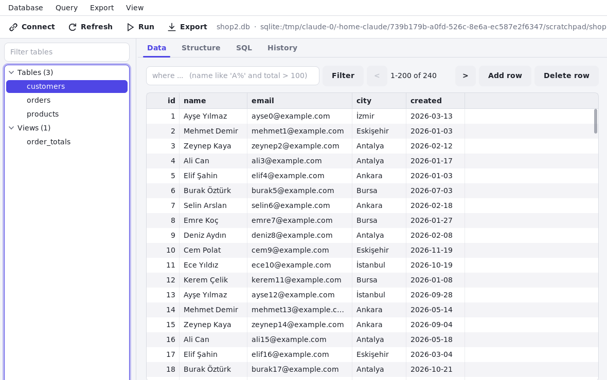
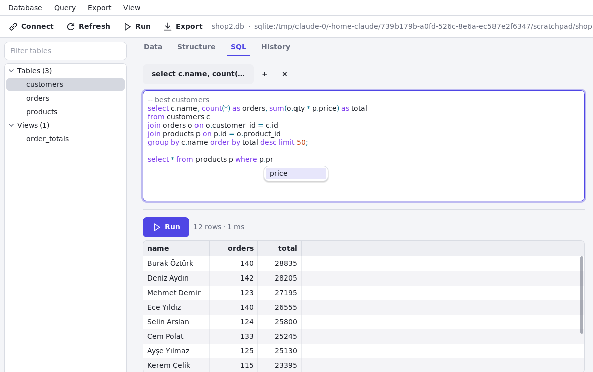
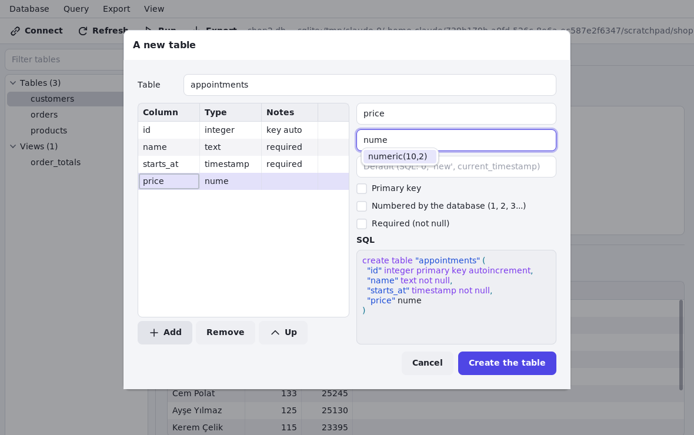

# Pastel DB

A small, fast database client for **SQLite, PostgreSQL and MySQL/MariaDB** — on Linux, Windows and Android.
Written in Object Pascal with [Pastel](https://github.com/azrov/pastel).



- **Tables and views** at the left (with a filter); a table's **rows** page by page, with a `where` filter
- **Change a cell** by double-clicking it (tables with a primary key); add and delete rows; `NULL` sets null
- The table's **structure**: columns, types, null, default, primary key
- **SQL editor**: colored SQL; table and column names offered while typing (`o.` after `from orders o` gives the
  columns of `orders`; Ctrl+Space); several statements at once (F5) or only the selected one; the rows of the
  last one and how long it took
- **Query tabs** (Ctrl+T, Ctrl+W), kept between runs, and the **history** of every query that ran (Ctrl+H),
  searchable, opened again with a double-click
- **New table** designer (Ctrl+N): columns, types, keys, numbering, defaults — with its SQL as you go, right for
  SQLite, PostgreSQL or MySQL
- **Import CSV and Excel** (Ctrl+I) into a table, or into a new one with the column types guessed; in one
  transaction (a bad row: none of them)
- **Export** the rows shown to **CSV, Excel (.xlsx), PDF or JSON**
- **Backup** and **restore** (SQLite file; `pg_dump` / `mysqldump` for servers), drop a table
- **Saved connections**; passwords kept by the system's keyring (never in a file)
- Dark mode





## Keys

| | |
|---|---|
| Ctrl+O | connect |
| F5 | run (the selection, else everything) |
| Ctrl+Space | names and keywords |
| Ctrl+T / Ctrl+W | new / close query tab |
| Ctrl+H | history |
| Ctrl+N | new table |
| Ctrl+I | import CSV / Excel |
| Ctrl+E | export |
| Ctrl+R | refresh |

## Small and quick

| | Pastel DB |
|---|---|
| The program (Linux, release) | 2.4 MB, one file |
| From start to the window | about 0.1 s |
| Runtime to install | none (SDL2 on Linux; `libpq` / `libmysqlclient` for those servers) |

## Building

```sh
pastel build                       # or: pastel run samples/shop.db
pastel test
pastel package appimage            # Linux; pastel package installer --target windows; pastel package apk
```

`samples/shop.db` is a small shop (customers, products, orders, a view) to try it with.

## License

MIT
